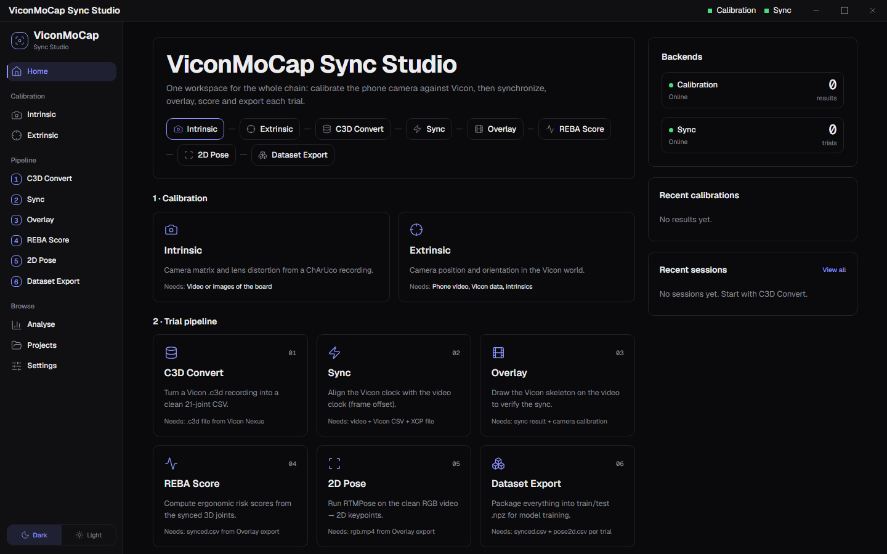
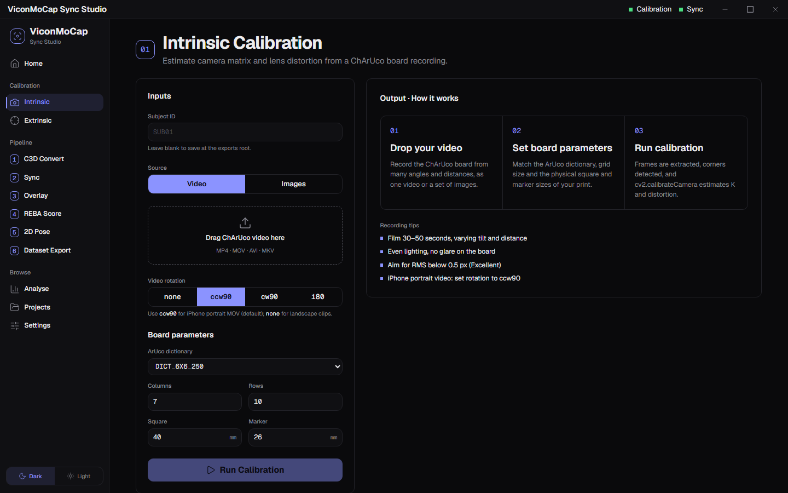
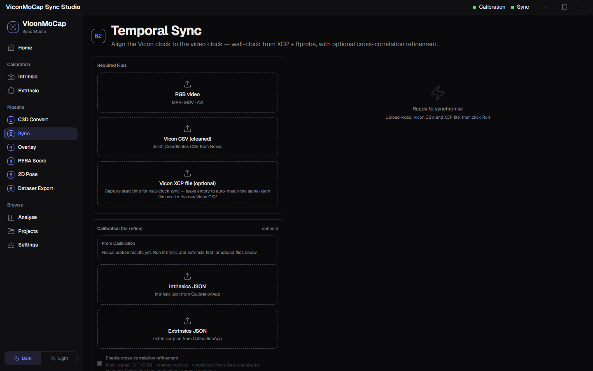
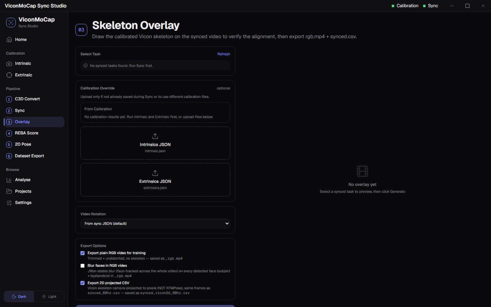
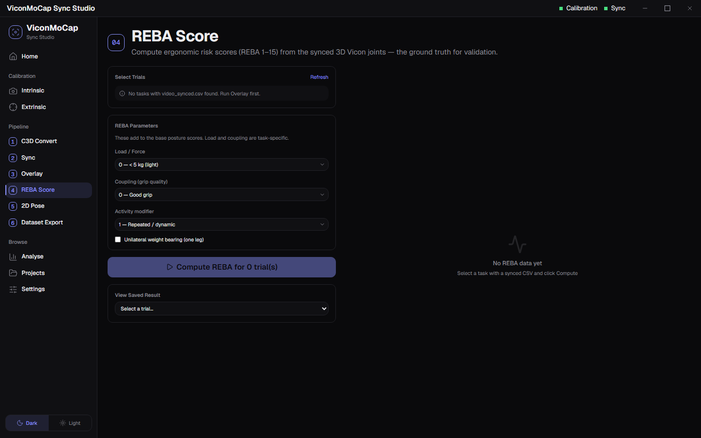
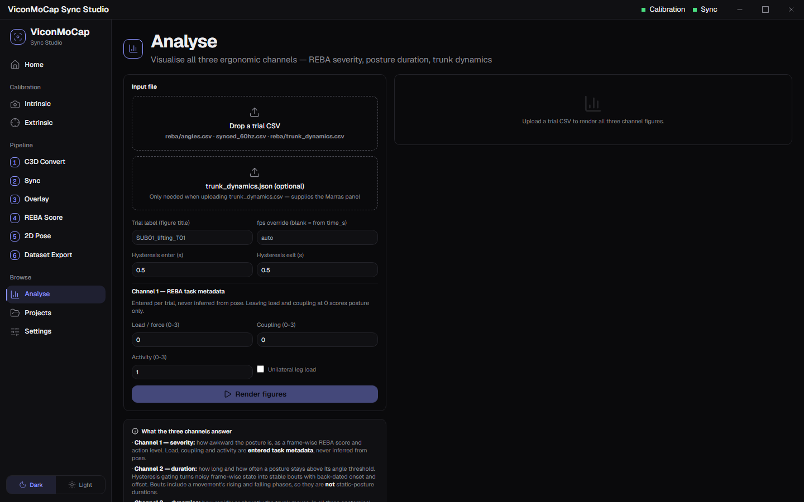
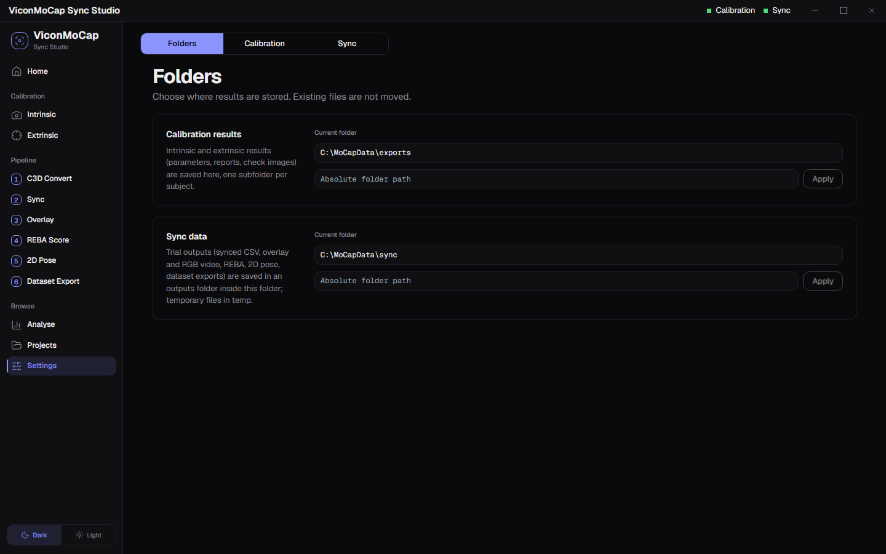

# ViconMoCap Sync Studio

A desktop application that takes a smartphone video and a Vicon motion-capture recording through the whole chain: **camera calibration**, **temporal synchronization**, **skeleton overlay**, **ergonomic (REBA) analysis**, **2D pose extraction** and **training-dataset export**. Everything runs locally in one window.



## Features

| Area | What it does |
|---|---|
| **Intrinsic calibration** | Camera matrix and lens distortion from a ChArUco board video or image set, with per-frame error plot and reprojection check images. |
| **Extrinsic calibration** | Camera pose in the Vicon world: board mode (ChArUco + Vicon markers) or body mode (click body joints on video frames), robust PnP with RANSAC and refinement. |
| **C3D convert** | Vicon `.c3d` to a clean 21-joint CSV, trimmed to the window where all joints are tracked, with per-joint data provenance. |
| **Sync** | Aligns the Vicon and video clocks from the XCP capture start time, optionally refined by cross-correlation of video motion and marker motion. |
| **Overlay** | Projects the Vicon skeleton onto the video to verify alignment and exports the synchronized RGB video and 3D/2D CSVs. |
| **REBA score** | Posture severity, high-risk posture duration and trunk dynamics as three separate channels. |
| **2D pose** | RTMPose-WholeBody keypoints mapped to the 21-joint layout, guided by the projected Vicon pelvis so bystanders are ignored. |
| **Dataset export** | Subject-wise train/validation/test windows (`.npz`) with provenance masks; trials with unconfirmed sync are blocked. |
| **Analyse** | Read-only figures from an uploaded CSV, without touching any trial. |



## Screenshots

| | |
|---|---|
|  |  |
|  |  |
|  |  |

## Requirements

- Windows 10/11 (the launcher and scripts are written for Windows; macOS and Linux are untested)
- [Miniconda](https://docs.conda.io/en/latest/miniconda.html) or Anaconda
- [Node.js](https://nodejs.org) 18 or newer
- FFmpeg on `PATH` (used for video normalization)
- Optional: an NVIDIA GPU with CUDA for faster 2D pose inference; the CPU is used otherwise

## Install and run

```bat
setup.bat    :: first time: two conda environments + npm install
start.bat    :: every time: opens the app (it starts both backends itself)
```

`setup.bat` creates two conda environments, one per backend (`calib_app` for calibration, `sync_app` for the pipeline), and installs the frontend dependencies.

### Browser-only development

```bat
conda activate calib_app && python calibration\backend\main.py
conda activate sync_app  && python sync\backend\main.py
cd frontend && npm run web        :: http://localhost:5174
```

## Where results are stored

Open **Settings → Folders** to choose the two output locations. Existing files are not moved.

| Setting | Default | Contents |
|---|---|---|
| Calibration results | `calibration/exports/` | intrinsic and extrinsic parameters, reports, check images, one subfolder per subject |
| Sync data | `sync/` (creates `outputs/` and `temp/` inside) | one folder per trial: synced CSV, overlay and RGB video, REBA, 2D pose, dataset exports |

Choices are saved in `calibration/config.json` and `sync/config.json` (both ignored by git).

## Typical workflow

1. **Intrinsic**: record a ChArUco board video for each camera and run the calibration once.
2. **Extrinsic**: once per recording session, solve the camera pose against the Vicon frame.
3. **C3D Convert** the trial, then **Sync** it. On the Sync and Overlay pages the *From Calibration* panel loads the latest calibration results so nothing is uploaded twice.
4. Check the **Overlay** video during the fast phase of the movement before trusting a trial.
5. Run **REBA Score**, **2D Pose** and **Dataset Export** as needed.

See the [user guide](docs/user-guide.md) for a step-by-step walkthrough of calibration and synchronization.

## Project layout

```
frontend/             Electron + Vue 3 + Tailwind (one window, one sidebar)
calibration/backend/  FastAPI service for calibration      (port 8765, env calib_app)
sync/backend/         FastAPI service for the pipeline      (port 8766, env sync_app)
docs/                 user guide, engineering notes, method notes
```

The frontend starts both backends from the Electron main process and talks to them over `127.0.0.1`; nothing is sent to the network.

## Development

```bat
cd frontend
npm run typecheck      :: vue-tsc
npm run build          :: Electron main, preload and renderer

cd sync\backend
python -m pytest       :: unit tests (needs pytest in the sync_app environment)
```

See [CONTRIBUTING.md](CONTRIBUTING.md) and [docs/engineering-notes.md](docs/engineering-notes.md).

## Assumptions and limitations

- The pipeline assumes an 8-task protocol (lifting, overhead work, forward trunk bending, squatting, kneeling, handling, carrying, trunk flexion with twisting) and subject IDs of the form `SUB01`. Trial folders are named `<subject>_<task>_T<NN>`.
- The Vicon marker set is a 21-point layout (see [engineering notes](docs/engineering-notes.md)).
- ISO 11226 holding-time limits are provisional and flagged as unverified in every output; see [docs/methods](docs/methods).
- Cross-correlation sync refinement depends on visible movement; always review trials flagged `needs_review`.

## Third-party components

- [RTMPose](https://github.com/open-mmlab/mmpose) via [rtmlib](https://github.com/Tau-J/rtmlib) for 2D keypoints (models are downloaded on first use).
- The BlazeFace model in `sync/backend/models_cache` is distributed with [MediaPipe](https://github.com/google-ai-edge/mediapipe) under Apache-2.0 and is used for optional face blurring.
- [ezc3d](https://github.com/pyomeca/ezc3d), OpenCV, FastAPI, Vue, Electron and Tailwind CSS, each under its own license.

## License

[MIT](LICENSE)
