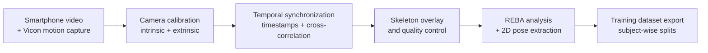
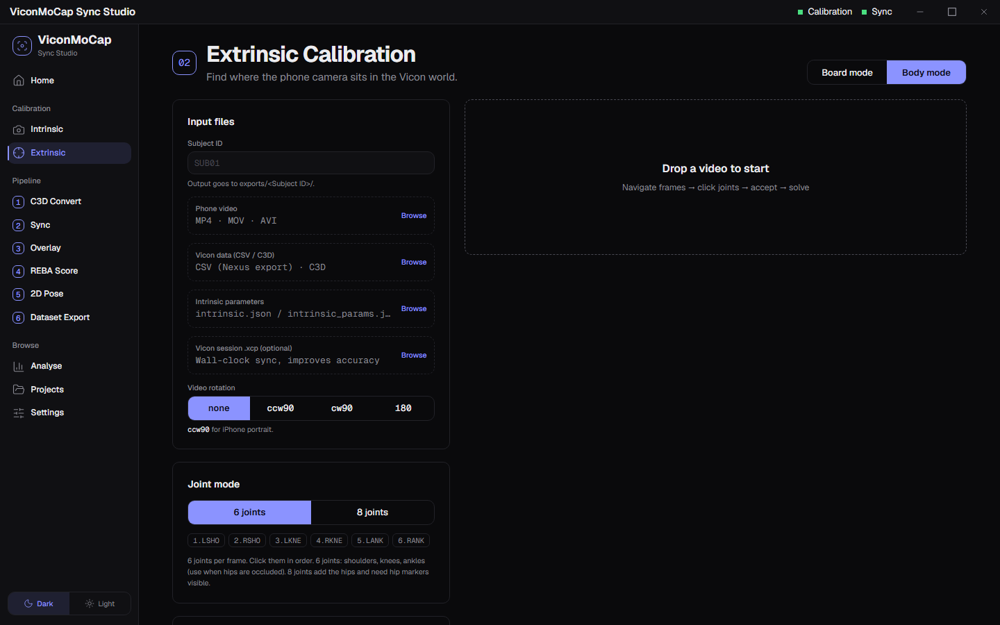

# ViconMoCap Sync Studio

A Windows desktop application that takes a smartphone video and a Vicon motion-capture recording through one pipeline: camera calibration, temporal synchronization, skeleton overlay, ergonomic (REBA) analysis, 2D pose extraction and training-dataset export. Video and motion-capture data are processed locally; nothing is uploaded.


## Overview

Training or validating a pose model against motion capture needs the two recordings to share one clock and one coordinate frame. This application automates that alignment and, at every step, shows the evidence for it: reprojection error plots, overlay videos, correlation scores and per-joint data provenance. A trial whose synchronization is unconfirmed cannot be exported.

## How it works



## Engineering highlights

- **Calibration.** Intrinsic parameters from ChArUco boards (`cv2.calibrateCamera`). Extrinsic pose in the Vicon world from `solvePnPRansac` plus Levenberg-Marquardt refinement, from a board with Vicon markers or from body joints clicked on video frames. Reprojection checks are written next to every result.
- **Temporal synchronization.** The Vicon capture start time and the video creation time give an initial offset that is only good to about one second. An optional cross-correlation of video optical flow with marker motion refines it, and the correction is applied only above a correlation threshold. Weak or contradictory evidence sets a `needs_review` flag.
- **Alignment verification.** The 3D skeleton is projected into the video with the calibrated camera, so a wrong offset or pose is visible on screen. A static pose looks aligned under any offset, so the guide tells the user to check the fast phase of the movement.
- **Motion-capture cleaning.** C3D files are converted to a 21-joint table, gap-filled, trimmed to the window where all joints are tracked, low-pass filtered once at the native rate and resampled to the video rate. Every sample carries a provenance label (`c3d`, `interpolated`, `recovered_csv`, `invalid`).
- **2D pose and joint mapping.** RTMPose-WholeBody keypoints are mapped to one canonical 21-joint layout. The person is selected by the projected Vicon pelvis, so bystanders in the lab are ignored, and low-confidence joints become NaN instead of guesses.
- **Ergonomic and kinematic analysis.** Signed trunk angles in a per-frame pelvis frame, REBA scoring, and angular velocity and acceleration. Posture severity, posture duration and trunk dynamics are reported as three separate channels and never fused into one score.
- **Dataset export.** Fixed-length windows with validity rules, split by subject so no person appears in two splits. Fitted parameters come from the training subjects only. Confidence, visibility and interpolation masks are exported with the data.
- **Application architecture.** An Electron + Vue 3 + TypeScript front end starts two local FastAPI services (calibration and pipeline), one conda environment each. The services accept only requests from the app's own origins and loopback host names, and file downloads and deletions are confined to the project folders.

### What is original and what is reused

| Written for this project | Used as is |
|---|---|
| The pipeline and its stage contracts; the synchronization and review logic; the 21-joint mapping and per-joint provenance; the trunk-angle and posture-duration code; subject-wise dataset export; the desktop application and its tests | OpenCV (ChArUco, PnP, camera calibration), RTMPose via rtmlib, ezc3d, SciPy filters, the REBA worksheet, FastAPI, Vue, Electron |

Conventions that the numerical results depend on are listed in [docs/engineering-notes.md](docs/engineering-notes.md).

## Core features

| Area | What it does |
|---|---|
| **Intrinsic calibration** | Camera matrix and lens distortion from a ChArUco board video or image set, with per-frame error plot and reprojection check images. |
| **Extrinsic calibration** | Camera pose in the Vicon world: board mode (ChArUco + Vicon markers) or body mode (click body joints on video frames), robust PnP with RANSAC and refinement. |
| **C3D convert** | Vicon `.c3d` to a clean 21-joint CSV, trimmed to the window where all joints are tracked, with per-joint data provenance. |
| **Sync** | Aligns the Vicon and video clocks from the XCP capture start time, optionally refined by cross-correlation of video motion and marker motion. |
| **Overlay** | Projects the Vicon skeleton onto the video to verify alignment and exports the synchronized RGB video and 3D/2D CSVs. |
| **REBA score** | Posture severity, high-risk posture duration and trunk dynamics as three separate channels. |
| **2D pose** | RTMPose-WholeBody keypoints mapped to the 21-joint layout, guided by the projected Vicon pelvis. |
| **Dataset export** | Subject-wise train/validation/test windows (`.npz`) with provenance masks; trials with unconfirmed sync are blocked. |
| **Analyse** | Read-only figures from an uploaded CSV, without touching any trial. |

## Screenshots

| | |
|---|---|
|  |  |
|  |  |
|  |  |

## Technology stack

| Layer | Technology |
|---|---|
| Desktop shell | Electron, electron-vite |
| Front end | Vue 3, TypeScript, Tailwind CSS, Three.js |
| Backends | Python 3.11, FastAPI, uvicorn |
| Computer vision and numerics | OpenCV, NumPy, SciPy, pandas, ezc3d |
| 2D pose | RTMPose-WholeBody (rtmlib, ONNX Runtime) |
| Tests and CI | pytest, ruff, vue-tsc, GitHub Actions |

## Installation

### Requirements

- Windows 10 or 11, 64-bit. macOS and Linux are untested.
- [Miniconda](https://docs.conda.io/en/latest/miniconda.html) or Anaconda. `setup.bat` creates two environments, `calib_app` and `sync_app` (Python 3.11).
- [Node.js](https://nodejs.org) 20.19 or newer.
- FFmpeg on `PATH`, used for video normalization.
- Optional: an NVIDIA GPU with a CUDA-capable driver for faster 2D pose inference. Without one the CPU is used.
- Disk space for two conda environments and the downloaded pose models; the environments are the large part (`sync_app` includes ONNX Runtime and MediaPipe).
- Internet access during setup (conda, pip and npm packages) and on the first 2D pose run (RTMPose models). After that the pipeline runs offline.

### Run

```bat
setup.bat    :: first time: two conda environments + npm ci
start.bat    :: every time: opens the app (it starts both backends itself)
```

`setup.bat` stops with an error message if an environment cannot be created or updated.

### Development without Electron

Run each command in its own terminal, from the repository root:

```bat
cd calibration\backend
conda activate calib_app
python main.py
```

```bat
cd sync\backend
conda activate sync_app
python main.py
```

```bat
cd frontend
npm run web
```

The web build is served at http://localhost:5174. The backends listen on `127.0.0.1:8765` (calibration) and `127.0.0.1:8766` (sync).

## Where results are stored

Open **Settings → Folders** to choose the two output locations. Existing files are not moved.

| Setting | Default | Contents |
|---|---|---|
| Calibration results | `calibration/exports/` | intrinsic and extrinsic parameters, reports, check images, one subfolder per subject |
| Sync data | `sync/` (creates `outputs/` and `temp/` inside) | one folder per trial: synced CSV, overlay and RGB video, REBA, 2D pose, dataset exports |

Choices are saved in `calibration/config.json` and `sync/config.json` (both ignored by git).

## Typical workflow

1. **Intrinsic**: record a ChArUco board video for each camera and run the calibration once.
2. **Extrinsic**: once per recording session, solve the camera pose against the Vicon frame.
3. **C3D Convert** the trial, then **Sync** it. On the Sync and Overlay pages the *From Calibration* panel loads the latest calibration results so nothing is uploaded twice.
4. Check the **Overlay** video during the fast phase of the movement before trusting a trial.
5. Run **REBA Score**, **2D Pose** and **Dataset Export** as needed.

See the [user guide](docs/user-guide.md) for a step-by-step walkthrough of calibration and synchronization.

## Testing and CI

```bat
cd calibration\backend && python -m pytest
cd sync\backend        && python -m pytest
cd frontend            && npm run typecheck && npm run build
```

GitHub Actions runs `ruff`, `compileall` and `pytest` for both backends on Ubuntu, the front-end typecheck and web build on Ubuntu, and the same backend tests plus the full Electron build on Windows. The tests cover geometry (PnP pose recovery, outlier rejection), C3D and CSV handling, dataset export rules, the extrinsic correction, and the local API protections. They do not drive the Electron window or process real recordings.

## Project layout

```
frontend/             Electron + Vue 3 + Tailwind (one window, one sidebar)
calibration/backend/  FastAPI service for calibration      (port 8765, env calib_app)
sync/backend/         FastAPI service for the pipeline      (port 8766, env sync_app)
docs/                 user guide, engineering notes, method notes
```

The front end starts both backends from the Electron main process and talks to them over `127.0.0.1`. See [CONTRIBUTING.md](CONTRIBUTING.md) and [SECURITY.md](SECURITY.md).

## Documentation

Designed for the documented motion-capture protocol. ISO 11226 duration limits are provisional. See the [engineering notes](docs/engineering-notes.md#assumptions-and-limitations) for supported inputs, validation limits and [third-party components](docs/engineering-notes.md#third-party-components).

## License and developer

[MIT](LICENSE). Developed by Azizbek Kakhkharov.
