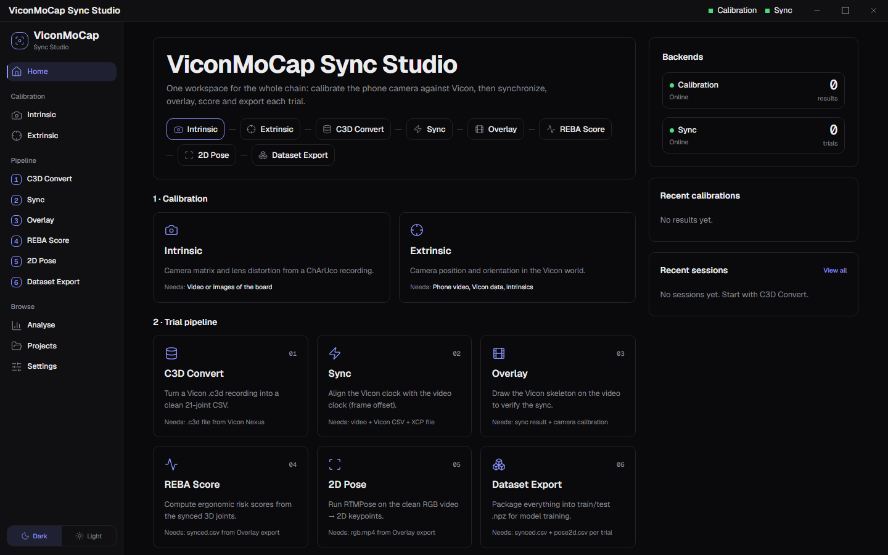
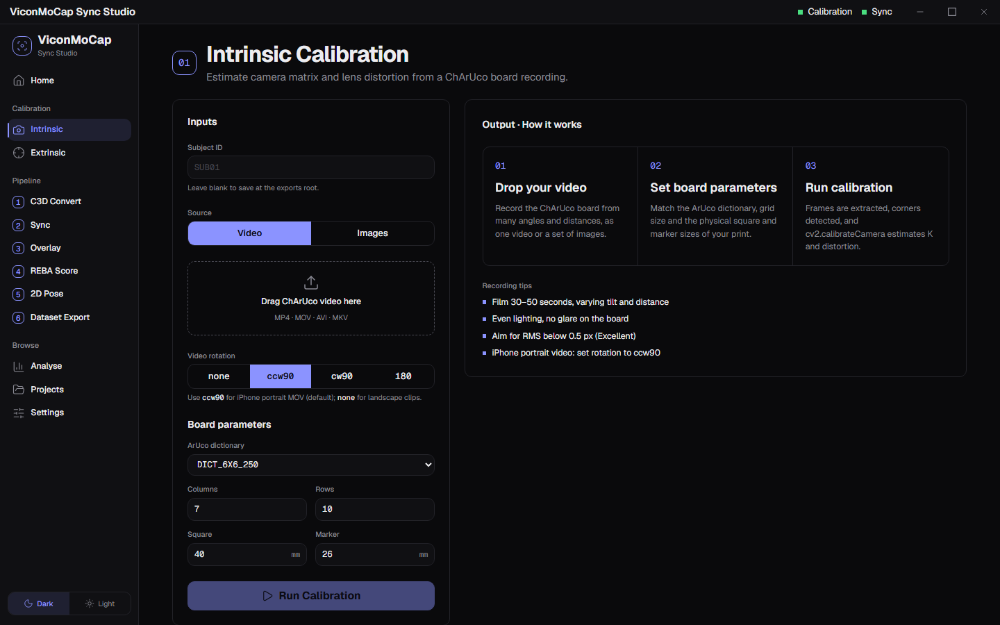
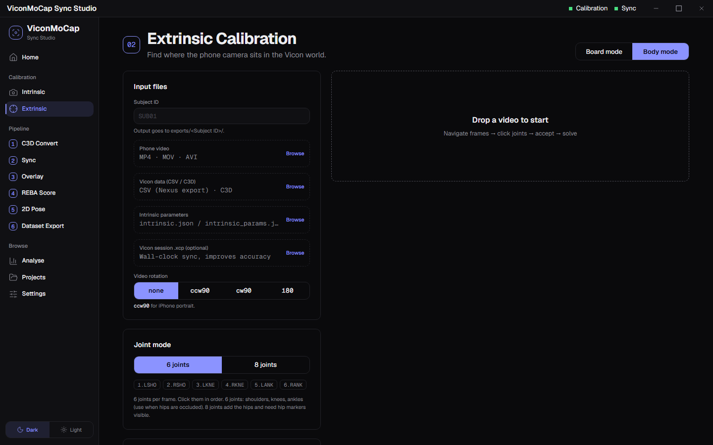
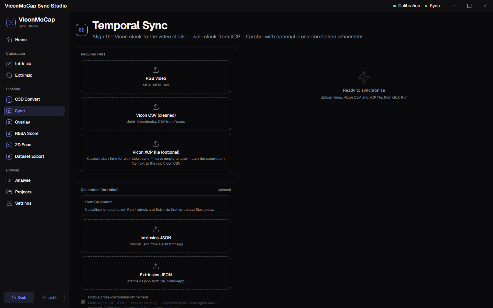
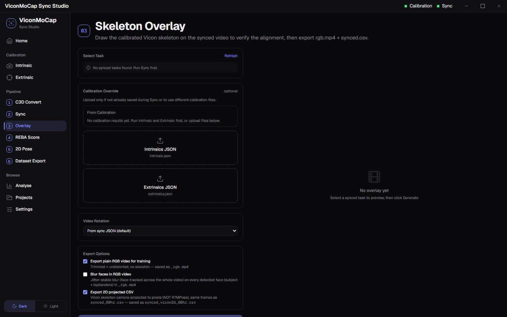
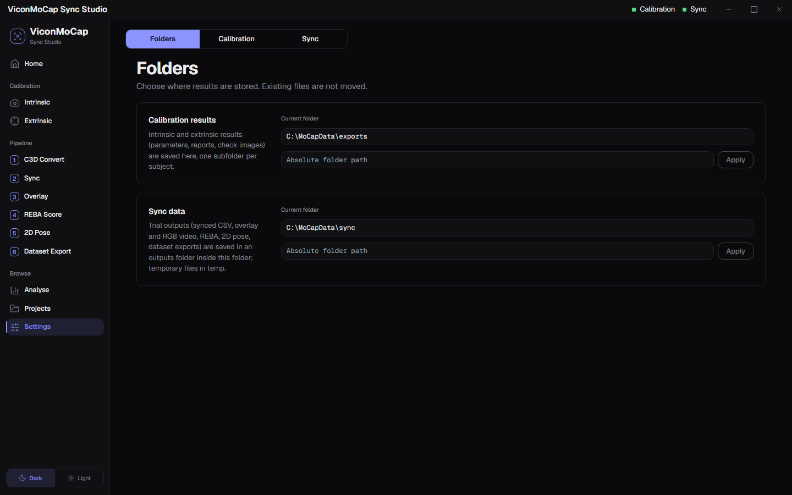

# User guide: calibration and synchronization

This guide covers the two jobs the app is built for:

1. **Calibrate** a smartphone camera against a Vicon capture volume (intrinsic, then extrinsic).
2. **Synchronize** a trial's video with its Vicon recording and verify the result with a skeleton overlay.



## Contents

- [Before you start](#before-you-start)
- [The big picture](#the-big-picture)
- [Part 1: Calibration](#part-1-calibration)
  - [1.1 Intrinsic calibration](#11-intrinsic-calibration)
  - [1.2 Extrinsic calibration, body mode](#12-extrinsic-calibration-body-mode)
  - [1.3 Extrinsic calibration, board mode](#13-extrinsic-calibration-board-mode)
  - [1.4 Managing calibration results](#14-managing-calibration-results)
- [Part 2: Synchronization](#part-2-synchronization)
  - [2.1 C3D Convert](#21-c3d-convert)
  - [2.2 Sync](#22-sync)
  - [2.3 Overlay](#23-overlay)
- [Settings](#settings)
- [Where files are saved](#where-files-are-saved)
- [Troubleshooting](#troubleshooting)

---

## Before you start

You need:

| Item | Used for |
|---|---|
| A video from the smartphone (MP4, MOV, AVI) | every step |
| A ChArUco board print and a video or images of it | intrinsic calibration |
| A Vicon recording: `.c3d` (and/or a Nexus CSV export) | extrinsic calibration, C3D Convert |
| The Vicon session `.xcp` file | wall-clock synchronization (strongly recommended) |

Open the app with `start.bat` (see the [README](../README.md#install-and-run)). The top bar shows whether the two backends are online. If either is offline, nothing in the matching section will work.

**Conventions used in the app**

- *Video rotation*: iPhone portrait clips are stored sideways and need `ccw90`. Landscape clips need `none`. The default is `ccw90`.
- *Subject ID*: a label such as `SUB01`. It becomes a folder name for the results.
- All processing is local; no file leaves the computer.

## The big picture

```
Intrinsic ──► Extrinsic ──────────────┐
(lens model)  (camera pose in Vicon)  │ results are reused, not re-uploaded
                                      ▼
C3D Convert ──► Sync ──► Overlay
(clean CSV)     (align    (draw skeleton on video,
                clocks)    check, export)
```

- Run **Intrinsic** once per camera and lens setup, and **Extrinsic** once per recording session. If the phone was moved, redo the extrinsic.
- Run **C3D Convert**, **Sync** and **Overlay** for every trial.
- On the Sync and Overlay pages, the **From Calibration** panel loads your latest calibration results directly, so no file has to be picked a second time.

---

# Part 1: Calibration

## 1.1 Intrinsic calibration

Estimates the camera matrix and the lens distortion from a ChArUco board recording. Open **Calibration → Intrinsic** in the sidebar.



### Recording the board

- Film for about 30 to 50 seconds. Tilt the board and change its distance so it appears at different angles and in all parts of the image.
- Use even lighting and avoid glare on the print.
- Use a flat, rigid board. Measure the printed square and marker sizes in millimetres; the numbers you enter must match the print.

### Steps

1. Enter a **Subject ID** (optional). Leave it blank to save at the root of the results folder.
2. Choose the **Source**: *Video* (drop one file) or *Images* (drop several JPG/PNG/BMP/TIFF files; at least 15 from different angles are recommended).
3. For video, set the **Video rotation** (`ccw90` for iPhone portrait).
4. Set the **Board parameters** to match your print:

   | Field | Default | Meaning |
   |---|---|---|
   | ArUco dictionary | `DICT_6X6_250` | must match the board's dictionary |
   | Columns / Rows | 7 / 10 | squares in X and Y |
   | Square | 40 mm | side of one square |
   | Marker | 26 mm | side of one ArUco marker (at most 0.8 of the square) |

5. Click **Run Calibration**. Frames are sampled, blurry ones are rejected, ChArUco corners are detected and the lens model is solved.

### Reading the result

| Rating | RMS reprojection error |
|---|---|
| Excellent | below 0.5 px |
| Good | 0.5 to 1.0 px |
| Poor | 1.0 px or more: recalibrate |

The result page also shows the camera matrix K, the distortion coefficients, the number of frames used, the image resolution and a per-frame error chart. The buttons at the top download the error plot, `intrinsic.json`, `intrinsic.yaml` and `intrinsic_params.npz`.

If the rating is Poor, record again with more angle variety and sharper frames, or check that the board size and dictionary you entered match the print.

## 1.2 Extrinsic calibration, body mode

Finds where the phone camera sits in the Vicon coordinate system, using body markers that you click in the video. Body mode is the default. Open **Calibration → Extrinsic** in the sidebar.



Use this mode when a person stood in the capture volume while both the phone and Vicon recorded. No board is needed.

### Steps

1. **Input files**: drop the *Phone video*, the *Vicon data* (`.csv` Nexus export or `.c3d`) and the *Intrinsic parameters* (`intrinsic.json`, `intrinsic_params.json` or `.npz` from step 1.1).
2. Optionally drop the Vicon session **`.xcp`** file. With it, the video and Vicon clocks are matched by wall-clock time and the sync search is narrowed to a ±2 s window, which improves accuracy. When an `.xcp` file is present, set the **Session timezone offset** to the UTC offset of the Vicon computer (for example `+5` for UTC+5).
3. Set the **Video rotation**.
4. Choose the **Joint mode**:
   - *6 joints*: left/right shoulder, knee, ankle. Use this when the hips are hidden.
   - *8 joints*: adds left/right hip; the hip markers must be visible.
5. Move through the video with the arrows or the slider and pick a frame where the person is clearly visible. The frame number shows in the header.
6. **Click the joints in the order shown** in the header (the next joint to click is highlighted). A magnifier helps with precise placement.
7. When all joints are marked, click **Accept frame**. To change a frame later, open it again and press *Re-accept*.
8. Accept **at least three frames**, ideally with the person in different positions. The counter shows `n / 3 min`. Use *Remove* in the list to drop a frame.
9. Click **Solve Body Extrinsic**.

### Reading the result

The result shows the inlier count, the sync offset that was found, the RMS error, the number of joints used and an error bar for each joint.

| Per-joint error | Meaning |
|---|---|
| below 2 px | good |
| 2 to 5 px | acceptable |
| above 5 px | poor: recheck the clicks |

A joint with a large error usually means a mis-clicked point or a wrong frame pairing. Remove that frame or click again, then solve again. The results are saved as `extrinsics.json` (and `.yaml`) with a report and reprojection check images, where a green circle is your click and a red cross is the reprojected Vicon point.

## 1.3 Extrinsic calibration, board mode

Uses a ChArUco board that has Vicon markers attached at its corners. Switch the toggle at the top right of the page to **Board mode**.

### Steps

1. Drop the *Phone video*, *Vicon data* and *Intrinsic parameters*. Optionally drop the `.xcp` file and set the timezone offset.
2. Set the **Video rotation**.
3. Under **Synchronization**, choose how the clocks are matched:
   - *manual*: enter the **Video frame #** and **Vicon frame #** of the same event (for example a clap or a flash visible in both).
   - *auto* or *timecode*: automatic matching. Adding an `.xcp` file switches to timecode automatically.
4. Open **Vicon marker mapping** and enter, for each physical board corner (top-left, top-right, bottom-left, bottom-right), the name of the Vicon marker attached there. Use the short name after the colon (`LEFT 11`, not `Test1:LEFT 11`). The bottom corners do not have to be visible in the video. Choose a Vicon frame in which all four markers have data.
5. Click **Run Extrinsic Calibration**.

The result shows the solver method, the RMS error, the camera pose, a reprojection plot and per-marker errors. Downloads: `extrinsic_params.json`, `extrinsic_params.npz` and the reprojection plot.

## 1.4 Managing calibration results

Open **Browse → Projects → Calibration results** to see every intrinsic and extrinsic run with its date, RMS error and quality rating. From a card you can open the JSON or delete the run (a confirmation dialog appears first).

---

# Part 2: Synchronization

## 2.1 C3D Convert

Turns a raw Vicon `.c3d` recording into a clean 21-joint CSV. Open **Pipeline → C3D Convert**.

### Steps

1. Drop the trial's **Vicon C3D file**.
2. Optionally drop a **Nexus raw CSV export** as a fallback. Frames that are empty in the C3D are filled from it.
3. Choose **Subject**, **Task** and **Trial** (for example `SUB01`, *Lifting*, `T01`). These three values decide the output folder, so the file name does not matter. The page shows the folder that will be written and warns if that trial already exists, because running again overwrites it.
4. Set **Max gap fill**. Marker gaps up to this many frames are filled by linear interpolation (default 10, maximum 30).
5. Click the run button.

When it finishes, the page shows the result and the clean CSV can be downloaded. Two buttons continue the work:

- **Go to Sync** moves to the next stage. The Subject, Task, Trial and the new CSV are handed over automatically.
- **Next trial** keeps the Subject and Task, increments the trial number and clears the files so you can drop the next C3D.

## 2.2 Sync

Aligns the Vicon clock to the video clock. Open **Pipeline → Sync**.



### Inputs

| Input | Notes |
|---|---|
| RGB video | the phone video of the trial |
| Vicon CSV (cleaned) | filled in for you after C3D Convert |
| Vicon `.xcp` file | holds the exact capture start time. Strongly recommended; without it you must supply *Manual video start* or *Force sync offset* |
| Intrinsics / Extrinsics JSON | optional. Needed only for cross-correlation refinement. Use **From Calibration** to load your latest results |

**Cross-correlation refinement** (on by default) improves the wall-clock result by comparing video motion with marker motion and picking the best available signal. The **Search window** sets how far from the wall-clock estimate it may look (default ±4 s). It takes about 1 to 3 minutes per trial.

### Parameters

| Field | Default | What to set |
|---|---|---|
| Subject, Task, Trial | from C3D Convert | decide the output folder |
| Timezone (UTC+N) | 5 | the UTC offset of the Vicon computer. **Change this to your own** |
| Clock correction (h) | 0 | only if the phone's clock was wrong when recording |
| Vicon FPS | 100 | the Vicon capture rate |
| Manual frame offset | 0 | a fixed extra shift in frames |
| Video rotation | `ccw90` | match the clip orientation |
| Manual video start | empty | override the video start time read from the file metadata |
| Force sync offset (s) | empty | a known-good offset that bypasses the timestamps entirely |

Click the run button to start.

### Reading the result

The top banner shows the **sync method** and the **offset**:

- *Wall-clock timestamps*: timestamps only.
- *Cross-correlation refined*: timestamps plus the motion-based refinement. The confidence label and the per-signal confidence list show how trustworthy the refinement is. If every signal has low confidence, the wall-clock offset is kept unchanged.

Other panels show the clock timestamps that were compared, the video and Vicon frame rates, and the processing time.

Trials flagged for review should be checked manually before they are used.

### When there is no overlap

If the page reports that the sync offset is wrong, the video time range does not overlap with valid Vicon data. Work through these in order:

1. **Timezone**: it must equal the UTC offset of the Vicon computer.
2. **Clock correction**: needed only if the phone clock was wrong. The page computes a suggested value from the file timestamps; press **Use this value** and run again.
3. **Force sync offset**: if you know a correct offset from an earlier run, type it in and run again.

### Fine-tune and continue

**Fine-tune Manual Offset** changes the saved offset in frames without re-running the whole pipeline. The **Next step** panel opens the Overlay page for the same trial.

## 2.3 Overlay

Draws the calibrated Vicon skeleton onto the synchronized video. This is the main way to **verify** a sync. Open **Pipeline → Overlay**.



### Steps

1. Under **Select Task**, click a synced trial to select it. Tick the boxes of several trials if you want to render them together later.
2. Under **Calibration Override**, normally nothing is needed because the calibration chosen during Sync is reused. Use **From Calibration** or the two file boxes only to try different calibration files.
3. Check the **Video Rotation** (the default reads it from the sync result).
4. Press **Generate Overlay Video**. The preview renders every frame and takes about 2 to 10 minutes depending on the video length and resolution.
5. Watch the video, especially during the fastest part of the movement. If the skeleton leads or lags the body, adjust the **Offset Fine-tune** in steps of ±1 or ±5 frames, then press **Save offset to sync JSON** and render again.
6. If the skeleton is correctly timed but sits slightly off the body, use the **Spatial Fine-tune** panel to nudge its position and tilt. This is saved into `extrinsics.json`, so every other trial that uses the same calibration benefits too.

### Export options

| Option | Result |
|---|---|
| Export plain RGB video | trimmed, undistorted video without the skeleton (`rgb.mp4`) |
| Blur faces in RGB video | blurs every detected face, tracked across the whole clip. Available when the plain RGB export is on |
| Export 2D projected CSV | Vicon skeleton projected through the camera into pixel coordinates (`synced_vicon2d_60hz.csv`) |

The synchronized 3D data is always written as `synced_60hz.csv`.

### Reading the result

| Metric | Meaning |
|---|---|
| Total frames / Trimmed frames | the video length before and after trimming to the valid Vicon range |
| Duration | length of the trimmed clip |
| Full skeleton | share of frames in which every joint is visible |

If **Full skeleton** is below 80 %, the page shows a warning. Check the sync offset, marker occlusion and the calibration.

A diagnostic image (`diagnostic_sync.png`) is also saved when cross-correlation was used.

**Run Batch** renders all ticked trials one after another, each with its own saved offset and without a preview step. Preview and tune a trial first, then use the batch for the rest.

The Overlay page needs the video and the Vicon CSV from the Sync step. If it reports missing files, run Sync for that trial again.

---

# Settings

Open **Settings**. The tabs are:



- **Folders**: where calibration results and sync data are saved. Pick a different folder with *Choose folder…*; existing files are not moved.
- **Calibration**: the default board geometry, how frames are extracted from a video, the RMS thresholds for the quality ratings and the PnP solver options (RANSAC and refinement).
- **Sync**: the sync data location.

The calibration and sync folders are stored in `calibration/config.json` and `sync/config.json`.

# Where files are saved

| What | Default location |
|---|---|
| Calibration results | `calibration/exports/<Subject ID>/` (one folder per run) |
| Trial data | `sync/outputs/<Subject>/<task>/` (per trial: clean CSV, sync result, overlay, RGB video, synced CSVs) |
| Temporary uploads | `sync/temp/` |

Both locations can be changed under **Settings → Folders**.

# Troubleshooting

| Symptom | What to check |
|---|---|
| A backend shows offline in the top bar | Run `setup.bat` again to create the environments, or start that backend by hand to see the error message. |
| Intrinsic rating is Poor | More angle and distance variety, sharper frames, and the board parameters must match the print. |
| Intrinsic finds too few frames | Lower the blur threshold or sample interval in **Settings → Calibration**, or use more images. |
| Extrinsic error is high on one joint | A click was wrong or the frame pairing is off. Remove that frame, click again, solve again. |
| "No overlap" after Sync | Check the timezone, then the clock correction (use the suggested value), then try Force sync offset. |
| Skeleton is early or late in the overlay | Adjust **Offset Fine-tune** and press *Save offset*. |
| Skeleton is correctly timed but offset in space | Use **Spatial Fine-tune**. If it is far off, redo the extrinsic. |
| Overlay says files are missing | Run Sync again for that trial. |
| Video looks sideways | Change the video rotation (`ccw90` for iPhone portrait, `none` for landscape). |
| Video is not normalized or converted | FFmpeg is missing from `PATH`. |
